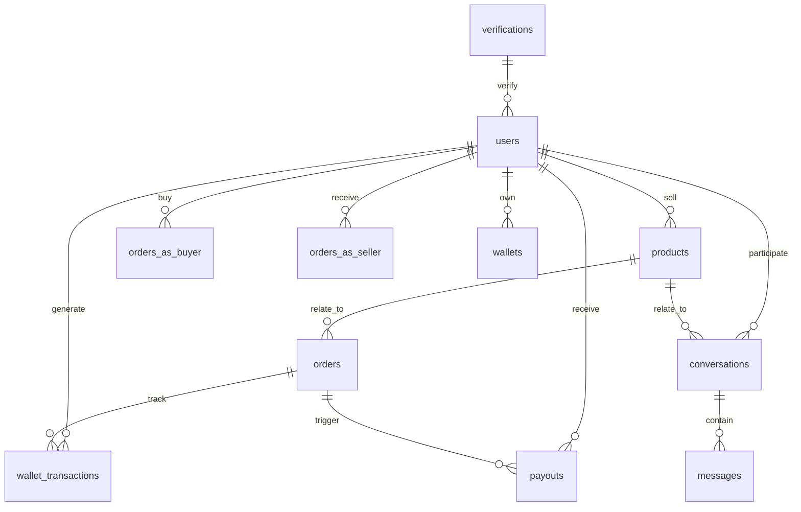
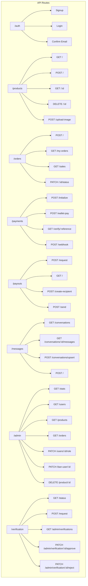
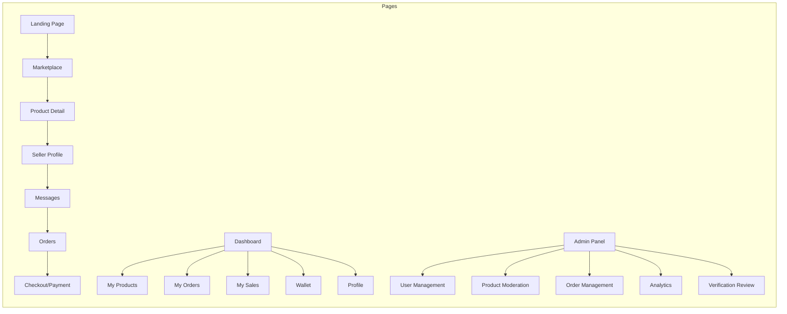
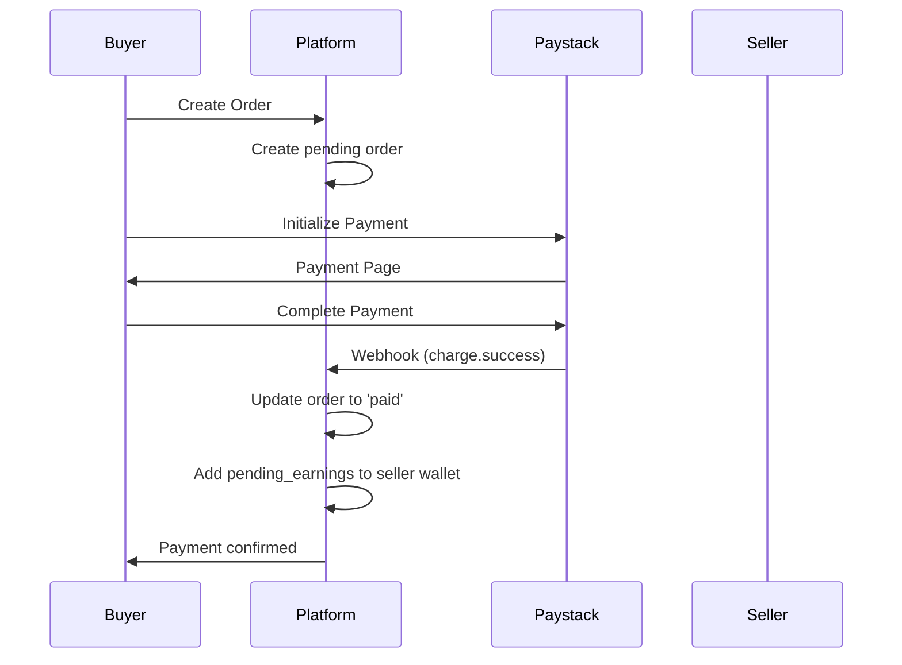
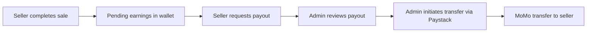

# White Market - Architecture Document

## Project Overview

**White Market** is a student-to-student online marketplace for the University of Ghana. It provides a centralized platform where students can list products, discover sellers, and transact directly with each other. The platform operates on a 10% commission model on each transaction.

### Mission
To become the primary marketplace for University of Ghana students, starting with campus-specific commerce and expanding to other universities across Ghana.

---

## System Architecture

### Technology Stack

```mermaid
graph TB
    subgraph "Frontend (Client)"
        A[Vite + React + TypeScript]
        B[Tailwind CSS]
        C[React Router]
        D[Recharts]
        E[Sonner (Toast)]
    end
    
    subgraph "Backend (Server)"
        F[Express.js]
        G[Node.js]
        H[Middleware Layer]
    end
    
    subgraph "Database & Auth"
        I[(Supabase PostgreSQL)]
        J[Supabase Auth]
        K[Supabase Storage]
        L[Row Level Security]
    end
    
    subgraph "External Services"
        M[Paystack API]
        N[Mobile Money Providers]
    end
    
    A --> F
    F --> I
    F --> J
    F --> M
    I --> L
```

### Infrastructure

| Component | Technology | Status |
|-----------|------------|--------|
| Frontend Framework | Vite + React + TypeScript | ✅ Completed |
| Styling | Tailwind CSS + shadcn/ui | ✅ Completed |
| Backend Runtime | Node.js 20+ | ✅ Completed |
| Backend Framework | Express.js | ✅ Completed |
| Database | Supabase (PostgreSQL) | ✅ Completed |
| Authentication | Supabase Auth | ✅ Completed |
| File Storage | Supabase Storage | ✅ Completed |
| Payment Gateway | Paystack | ✅ Completed |
| Mobile Money | MTN/Vodafone/AirtelTigo | ✅ Completed |

---

## Database Schema

### Core Tables



### Table Definitions

#### 1. Users Table (`public.users`)
**Status: ✅ Completed**

| Column | Type | Description |
|--------|------|-------------|
| id | uuid | Primary key (FK to auth.users) |
| full_name | text | User's full name |
| email | text | Unique email address |
| role | text | user/seller/admin/banned |
| avatar_url | text | Profile picture URL |
| campus | text | Campus location |
| whatsapp | text | WhatsApp number |
| momo_number | text | Mobile Money number |
| momo_provider | text | MTN/Vodafone/AirtelTigo |
| paystack_recipient_code | text | Paystack transfer recipient |
| verified | boolean | Student verification status |
| verification_status | text | none/pending/approved/rejected |
| created_at | timestamptz | Account creation time |
| updated_at | timestamptz | Last update time |

#### 2. Products Table (`public.products`)
**Status: ✅ Completed**

| Column | Type | Description |
|--------|------|-------------|
| id | uuid | Primary key |
| seller_id | uuid | FK to users |
| title | text | Product name |
| description | text | Product details |
| price | numeric | Price in GHS |
| image_url | text | Product image |
| created_at | timestamptz | Creation time |

#### 3. Orders Table (`public.orders`)
**Status: ✅ Completed**

| Column | Type | Description |
|--------|------|-------------|
| id | uuid | Primary key |
| product_id | uuid | FK to products |
| buyer_id | uuid | FK to users |
| seller_id | uuid | FK to users |
| amount | numeric | Order total in GHS |
| status | text | pending/paid/cancelled |
| payment_reference | text | Paystack reference |
| paid_at | timestamptz | Payment completion time |
| created_at | timestamptz | Creation time |

#### 4. Wallets Table (`public.wallets`)
**Status: ✅ Completed**

| Column | Type | Description |
|--------|------|-------------|
| user_id | uuid | FK to users (PK) |
| balance | numeric(12,2) | Available balance |
| pending_earnings | numeric(12,2) | Pending payout amount |
| currency | text | GHS |
| created_at | timestamptz | Creation time |
| updated_at | timestamptz | Last update |

#### 5. Wallet Transactions (`public.wallet_transactions`)
**Status: ✅ Completed**

| Column | Type | Description |
|--------|------|-------------|
| id | uuid | Primary key |
| user_id | uuid | FK to users |
| type | text | credit/debit/withdrawal/refund/pending |
| amount | numeric(12,2) | Transaction amount |
| description | text | Transaction description |
| reference_id | text | Related entity ID |
| balance_after | numeric(12,2) | Balance after transaction |
| created_at | timestamptz | Transaction time |

#### 6. Payouts Table (`public.payouts`)
**Status: ✅ Completed**

| Column | Type | Description |
|--------|------|-------------|
| id | uuid | Primary key |
| seller_id | uuid | FK to users |
| order_id | uuid | FK to orders |
| amount | numeric | Payout amount (90% of order) |
| status | text | pending/sent/failed |
| created_at | timestamptz | Creation time |

#### 7. Conversations Table (`public.conversations`)
**Status: ✅ Completed**

| Column | Type | Description |
|--------|------|-------------|
| id | uuid | Primary key |
| product_id | uuid | FK to products |
| buyer_id | uuid | FK to users |
| seller_id | uuid | FK to users |
| created_at | timestamptz | Creation time |
| updated_at | timestamptz | Last message time |

**Constraints:** buyer_id != seller_id

#### 8. Messages Table (`public.messages`)
**Status: ✅ Completed**

| Column | Type | Description |
|--------|------|-------------|
| id | uuid | Primary key |
| conversation_id | uuid | FK to conversations |
| sender_id | uuid | FK to users |
| text | text | Message content |
| image_url | text | Optional image |
| status | text | sent/delivered/read |
| created_at | timestamptz | Message time |

**Constraints:** text OR image_url must be present

#### 9. Verifications Table (`public.verifications`)
**Status: ✅ Completed**

| Column | Type | Description |
|--------|------|-------------|
| id | uuid | Primary key |
| user_id | uuid | FK to users |
| document_type | text | student_id/admission_letter |
| status | text | pending/approved/rejected |
| reviewed_by | uuid | FK to users (admin) |
| rejection_reason | text | Rejection explanation |
| created_at | timestamptz | Request time |
| updated_at | timestamptz | Review time |

---

## Backend API Architecture

### Route Structure



### Middleware

| Middleware | File | Purpose | Status |
|------------|------|---------|--------|
| requireAuth | `backend/src/middleware/requireAuth.js` | Verify JWT token | ✅ Completed |
| requireAdmin | `backend/src/middleware/requireAdmin.js` | Verify admin role | ✅ Completed |
| upload | `backend/src/middleware/upload.js` | File upload handling | ✅ Completed |

### Security Features

| Feature | Implementation | Status |
|---------|----------------|--------|
| Rate Limiting | IP-based global and per-route limits | ✅ Completed |
| CORS Control | Origin validation for production | ✅ Completed |
| Security Headers | X-Content-Type, X-Frame-Options, etc. | ✅ Completed |
| RLS | Row Level Security on all tables | ✅ Completed |
| SQL Injection | Parameterized queries via Supabase | ✅ Completed |
| Webhook Signature | Paystack signature verification | ✅ Completed |

---

## Frontend Architecture

### Page Structure



### Key Components

| Component | File | Status | Description |
|------------|------|--------|-------------|
| Navbar | `src/Navbar.tsx` | ✅ Completed | Navigation header |
| Footer | `src/Footer.tsx` | ✅ Completed | Site footer |
| MobileBottomNav | `src/MobileBottomNav.tsx` | ✅ Completed | Mobile navigation |
| Index | `src/Index.tsx` | ✅ Completed | Landing page |
| AddProduct | `src/AddProduct.tsx` | ✅ Completed | Product listing form |
| ProductGrid | `src/ProductGrid.tsx` | ✅ Completed | Product display grid |
| SellerProfile | `src/SellerProfile.tsx` | ✅ Completed | Seller information |
| ProfessionalOrdersPage | `src/ProfessionalOrdersPage.tsx` | ✅ Completed | Order management |
| OrderPipeline | `src/OrderPipeline.tsx` | ✅ Completed | Order status flow |
| AdminDashboardView | `src/AdminDashboardView.tsx` | ✅ Completed | Admin panel |
| VerifyStudent | `src/VerifyStudent.tsx` | ✅ Completed | Student verification |
| BuyerProtection | `src/BuyerProtection.tsx` | ✅ Completed | Buyer safety info |
| PrivacyPolicy | `src/PrivacyPolicy.tsx` | ✅ Completed | Privacy policy page |
| TermsOfService | `src/TermsOfService.tsx` | ✅ Completed | Terms page |
| FAQ | `src/FAQ.tsx` | ✅ Completed | FAQ page |
| ReportIssue | `src/ReportIssue.tsx` | ✅ Completed | Issue reporting |

### API Client (`src/api.ts`)

| API Module | Endpoints | Status |
|------------|-----------|--------|
| authApi | signup, login, logout | ✅ Completed |
| productsApi | CRUD operations, image upload | ✅ Completed |
| ordersApi | create, list, status update | ✅ Completed |
| paymentsApi | initialize, verify, wallet-pay | ✅ Completed |
| payoutsApi | request, list, recipient | ✅ Completed |
| messagesApi | conversations, messages | ✅ Completed |
| adminApi | stats, user management | ✅ Completed |
| verificationApi | status, request, review | ✅ Completed |

---

## Key Business Logic

### 1. Commission Model
- **Rate:** 10% on each transaction
- **Flow:** Buyer pays → Platform holds → 90% to seller, 10% retained

### 2. Payment Flow


### 3. Wallet System
- Buyers can top up wallet (simulated in dev)
- Wallet used for instant payments
- Seller earnings held as pending until payout requested

### 4. Payout Process


### 5. Student Verification
- **Auto-verify:** Users with @st.ug.edu.gh or @ug.edu.gh emails
- **Manual review:** Others submit student ID/admission letter
- **Admin approval:** Required for non-school emails

---

## Security Implementation

### Row Level Security (RLS) Policies

| Table | Policy | Access Control |
|-------|--------|----------------|
| users | users_select_own | Users see own profile |
| users | users_update_own | Users update own profile |
| users | users_admin_manage | Admins manage all |
| products | products_select_all | Public read access |
| products | products_insert_own | Authenticated create |
| products | products_update_own | Owner/Admin update |
| orders | orders_select_participants | Buyer/Seller/Admin |
| orders | orders_insert_buyer | Authenticated create |
| wallets | wallets_select_own | Owner only |
| wallet_transactions | wallet_transactions_select_own | Owner only |
| conversations | conversations_select_participants | Participants only |
| messages | messages_select_participants | Conversation participants |

### Authentication
- JWT tokens via Supabase Auth
- Token stored in localStorage and Supabase session
- Automatic token refresh
- Protected routes require valid JWT

---

## Environment Configuration

### Required Environment Variables

#### Frontend (.env)
```
VITE_API_URL=http://localhost:5000
VITE_SUPABASE_URL=...
VITE_SUPABASE_ANON_KEY=...
VITE_PAYSTACK_PUBLIC_KEY=...
```

#### Backend (backend/.env)
```
NODE_ENV=development
PORT=5000
SUPABASE_URL=...
SUPABASE_ANON_KEY=...
SUPABASE_SERVICE_ROLE_KEY=...
FRONTEND_URL=http://localhost:5173
ALLOWED_EMAIL_DOMAINS=st.ug.edu.gh,ug.edu.gh
PAYSTACK_SECRET_KEY=...
PAYSTACK_CALLBACK_URL=http://localhost:5173/payments/callback
ENABLE_TEST_ROUTES=true
ALLOW_SIMULATED_WALLET_TOPUP=true
```

---

## Project Structure Summary

```
white-market/
├── frontend/                    # Vite + React frontend
│   ├── src/
│   │   ├── api.ts              # API client layer
│   │   ├── App.tsx             # Main app component
│   │   ├── components/         # Reusable components
│   │   ├── pages/              # Page components
│   │   └── hooks/              # Custom React hooks
│   └── package.json
│
├── backend/                    # Express.js backend
│   ├── src/
│   │   ├── index.js           # Express app setup
│   │   ├── routes/            # API route handlers
│   │   ├── middleware/        # Auth middleware
│   │   └── lib/               # Utilities
│   └── package.json
│
├── supabase/                   # Database migrations
│   └── migrations/
│       ├── 20260307_security_hardening.sql
│       └── 20260308_payment_atomicity.sql
│
└── package.json               # Root package.json
```

---

## Completed Features Summary

### Core Marketplace Features ✅
- [x] User authentication (signup, login)
- [x] Product listing and browsing
- [x] Product search functionality
- [x] Order creation and management
- [x] Real-time messaging between buyers/sellers

### Payment System ✅
- [x] Paystack integration for card payments
- [x] Internal wallet system
- [x] Wallet top-up (simulated in dev)
- [x] Payment via wallet balance
- [x] Webhook handling for payment confirmation

### Payout System ✅
- [x] Automatic commission calculation (10%)
- [x] Seller pending earnings tracking
- [x] Payout request system
- [x] Paystack transfer recipient creation
- [x] MoMo transfer to sellers (MTN/Vodafone/AirtelTigo)

### Verification System ✅
- [x] Auto-verification for UG email domains
- [x] Manual verification request (student ID/admission letter)
- [x] Admin verification approval/rejection

### Admin Features ✅
- [x] Dashboard with statistics
- [x] User management (view, ban, unban, role changes)
- [x] Product moderation (view, delete)
- [x] Order management (view, status updates)
- [x] Verification request review

### Frontend UI ✅
- [x] Landing page with hero section
- [x] Product grid with search
- [x] Seller profiles
- [x] Order management pages
- [x] Wallet display
- [x] Mobile-responsive design
- [x] Mobile bottom navigation

### Security ✅
- [x] Row Level Security on all tables
- [x] JWT authentication
- [x] Rate limiting
- [x] CORS configuration
- [x] Security headers
- [x] Webhook signature verification

---

## Potential Future Enhancements

### Phase 2 Suggestions
1. **Categories & Filtering** - Add product categories, price filters, sorting
2. **Reviews & Ratings** - Buyer reviews for sellers
3. **Push Notifications** - In-app and/or push notifications
4. **Search History** - Save and display recent searches
5. **Favorites/Wishlist** - Save products for later
6. **Referral System** - Invite friends and earn credits
7. **Multi-University Expansion** - Campus selection, university-specific features

### Technical Improvements
1. **Real-time Updates** - Supabase Realtime for messages and notifications
2. **Image Optimization** - Compress and resize uploaded images
3. **Search Indexing** - Full-text search with PostgreSQL
4. **Analytics Dashboard** - Seller performance metrics
5. **Email Notifications** - Transaction confirmations, verification updates
6. **Mobile App** - React Native or Flutter wrapper

---

## Deployment Checklist

From `PREHOSTING_CHECKLIST.md`:

1. ✅ Set `NODE_ENV=production` in backend
2. ✅ Configure non-localhost URLs for FRONTEND_URL, PAYSTACK_CALLBACK_URL
3. ✅ Set real SUPABASE_* and PAYSTACK_SECRET_KEY values
4. ✅ Disable test routes (`ENABLE_TEST_ROUTES=false`)
5. ✅ Block simulated wallet top-up (`ALLOW_SIMULATED_WALLET_TOPUP=false`)
6. ✅ Run database migrations in Supabase SQL editor
7. ✅ Configure Paystack webhook to `/payments/webhook`
8. ✅ Test all payment flows in staging

---

*Document Version: 1.0*
*Last Updated: March 2026*
*Project: White Market - University of Ghana Student Marketplace*